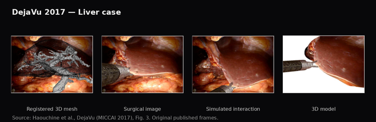
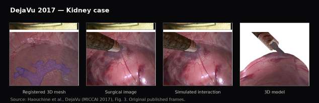
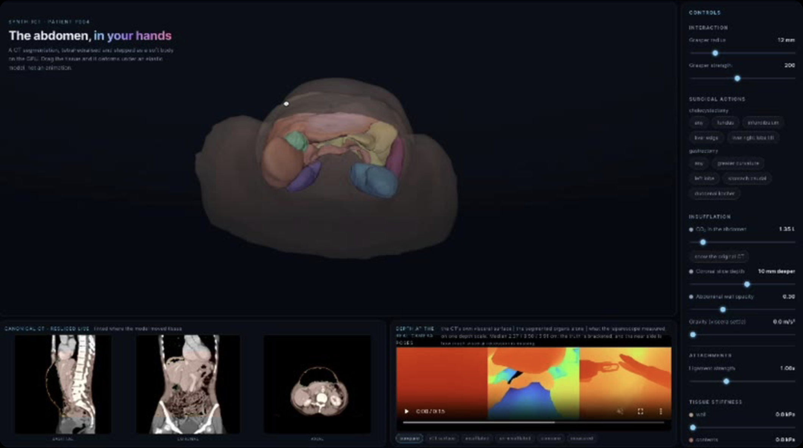
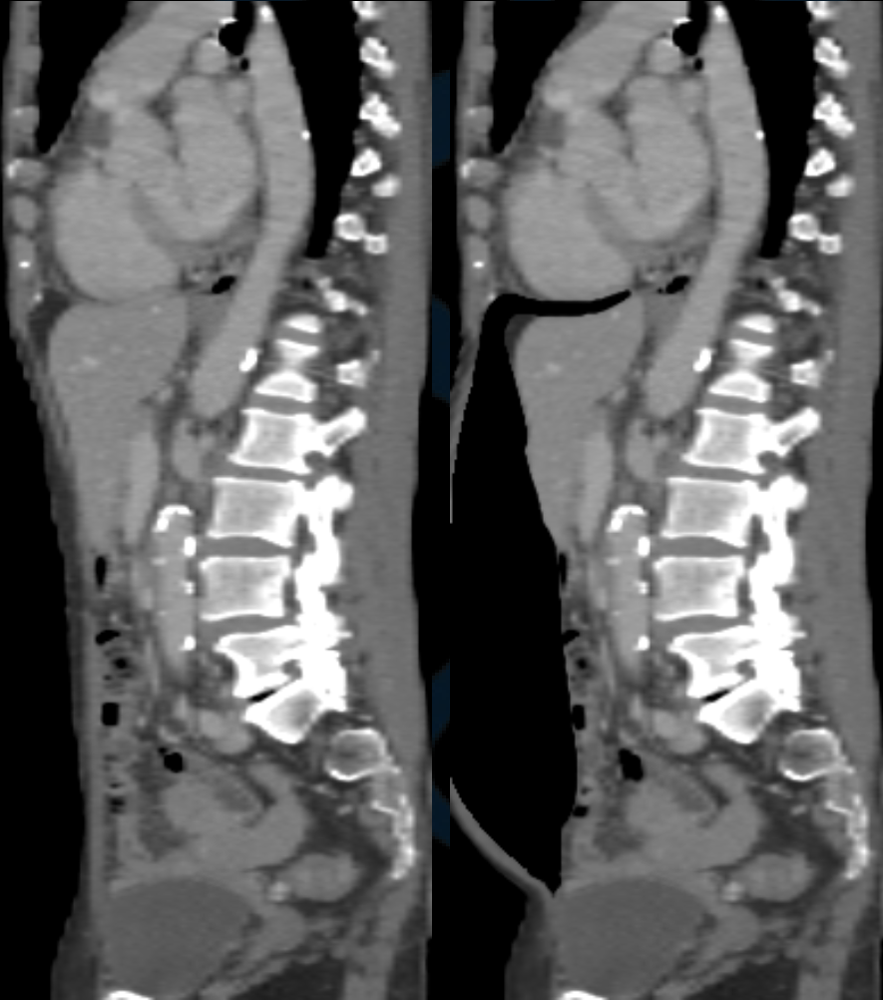
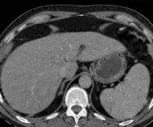
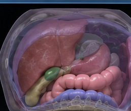

<!-- _class: title -->
<!-- _paginate: false -->

AI in Surgery · WS 26/27 · Kick-off

# Simulating Insufflation

From the pre-operative CT to the insufflated abdomen, tuned with laparoscopic video

Adrian Nikaeen &nbsp;·&nbsp; Boldizsar Horvath &nbsp;·&nbsp; Daria Rekretiuk &nbsp;·&nbsp; Emilian Denkov

Tutor: Maximilian Fehrentz &nbsp;&nbsp;|&nbsp;&nbsp; 27.11.2026

---

01 · Problem

# Insufflation changes the anatomy

<video class="bigvideo" src="assets/problem_ct_insufflation.mp4" poster="assets/problem_ct_insufflation_poster.png" autoplay loop muted playsinline></video>

<!--
- Surgery is planned on the pre-operative CT, which is taken without gas.
- In the OR CO2 is blown into the gap between the abdominal wall and the organs, held at 12 to 15 mmHg.
- The wall lifts by several centimetres and the organs are pushed down. The back lies on the table and stays fixed.
- So the pre-op CT no longer matches the patient. Planned trocar positions and wall vessels are off.
- And in patients nobody takes a second CT after insufflation, so the real insufflated anatomy is unknown. (Only for our pigs we have one.)
-->

---

02 · Motivation

# Why it also matters for guidance and simulation

<h3>1&nbsp; Intra-operative guidance</h3>

After insufflation the organs shift and deform. The pre-op 3D mesh no longer matches the camera image, so a rigid registration is not enough. A good prediction of the insufflated anatomy gives the registration a much better starting point.

<h3>2&nbsp; Surgical physics simulation</h3>

Simulators for rehearsal, tool–tissue interaction or cutting start from the pre-op CT shape. Without insufflation, every later step runs on the wrong geometry. DejaVu names this deformation as an open problem.

<b class="hl">Why start with insufflation?</b> It is the first deformation in every laparoscopy, before any cutting, and for the porcine cases we have the post-insufflation CT as ground truth.

<!--
MOTIVATION (about 1 min)
- Two reasons beyond planning.
- 1, guidance: overlaying the pre-op model on the video needs a registration. After insufflation the organs have moved, so a rigid alignment fails. If we can predict the insufflated anatomy, registration starts much closer to the truth.
- 2, simulation: any physics simulator (rehearsal like DejaVu, tool-tissue interaction, cutting) starts from the pre-op shape. If insufflation is missing, everything afterwards is computed on the wrong geometry. DejaVu's authors name exactly this deformation as an open problem.
- Images are from DejaVu (Haouchine et al. 2017), not our results.
- Why insufflation first: it happens in every laparoscopy, before cutting, and the pig CTs give us ground truth.
-->

---

03 · Starting point &amp; research questions

# Where we start, where we go

<b>Where we start:</b> interactive insufflation simulator in NVIDIA Newton

pre-op CTsimulated, 12 mmHg

<b>What exists</b>A pressure-driven soft-tissue simulation of the abdomen in Newton, with many open issues.

<b class="hl">Ground truth</b>The real post-insufflation CTs of our 16&nbsp;porcine.

<b class="gas">Where we go</b>A simulation that approximates the real insufflation.

### Questions to answer

- How does soft-tissue simulation work, and which methods are relevant?
- How far can we get modelling tissue properties, attachment points and the abdominal wall, using only our existing semantics and agents?

<!--
WHERE WE START, WHERE WE GO (about 1 min)
- Starting point: Max's interactive insufflation simulator in NVIDIA Newton. A pressure-driven soft-tissue skeleton exists, with many open issues.
- Example on the right: a human pre-op CT and the simulated state at 12 mmHg.
- Ground truth for us: the real post-insufflation CTs of the 16 pigs.
- Questions: how does soft-tissue simulation work and which methods matter? How far do we get with tissue properties, attachment points and the abdominal wall using only the semantics (segmentations) and agents we already have?
- Transition: the next slides show how Bano et al. 2012 did this, which is our starting baseline.
-->

---

04 · Literature · Simulation

# Bano et al. 2012: from pre-op CT to predicted anatomy

Anatomy before insufflation → biomechanical simulation → estimated shape after insufflation.

<h3>Initial state Pre-operative CT</h3>

Before CO₂ insufflation

<h3>Simulation pipeline</h3>

1Segment<i>3D anatomy</i>

2Mesh<i>surface + volume</i>

3Materials<i>tissue stiffness</i>

4Simulate<i>FEM + pressure</i>

5Evaluate<i>against CT</i>

Pressure-driven tissue deformation with contacts

<h3>Output Predicted insufflated anatomy</h3>

Estimated post-gas shape

Bano et al. report mean errors of roughly 3–6 mm for selected structures in two porcine subjects.

Images are illustrative; they are not actual patient scans or measured predictions from the paper.

<!--
LITERATURE: SIMULATION, Bano et al. MICCAI 2012 (about 1 min)
- Pre-op CT is segmented into three regions: abdominal wall, abdominal viscera, thoracic viscera. Arteries optional if contrast.
- Tetrahedral volume meshes for FEM, surface meshes for collision.
- Material: wall E = 24 kPa (nu = 0.49), viscera 15 kPa, thoracic 7 kPa, diaphragm ten times the wall. Measured values, not fitted.
- Simulation in SOFA: inverse gravity first (the CT already contains gravity), then 12 mmHg on the inner wall surface, back fixed on the table.
- Result on 2 pigs: about 3 to 4 mm mean error for skin, wall and organs, about 5 mm for the arteries.
- This is our step 1 baseline.
-->

---

05 · Data

# What we work with

| | Porcine · 16 cases | Human · 3 cases |
|---|---|---|
| CT | Before and after insufflation | Pre-op contrast CT only |
| Segmentations | Vessels, ureters, tumour mimic; organs being added | Organs |
| Video | Tracked monocular | Tracked stereo |
| Evaluation | Post-insufflation CT reference | Qualitative check; registration varies |

Data remain on the chair’s cluster. Representative project images still need to be added.

---

06 · 3D vision

# From laparoscopic video to 3D

Tracked laparoscopic video

→

Depth estimation

→

3D surface in CT coordinates

### Porcine data
Monocular video · Depth Anything 3

Recover and verify scale using available tracking and calibration.

### Human data
Stereo video · FoundationStereo

Assess reconstruction and registration quality.

Related work: BridgeSplat (MICCAI 2025). Method details to be confirmed by Pair B.

---

07 · Simulation · MPM

# MPM: linking computer vision and simulation

Material Point Method

Particles carry tissue properties and motion; a background grid is used to compute forces and update motion.

CT + reconstructed surface

→

Material points ↔ grid

→

Deformed geometry

●●●●●● ●●●●●● ●●●●●●

▦▦▦▦▦▦ ▦▦▦▦▦▦ ▦▦▦▦▦▦

●&nbsp;●&nbsp;●&nbsp;● &nbsp;●&nbsp;●&nbsp;●&nbsp;● &nbsp;&nbsp;●&nbsp;●&nbsp;●&nbsp;●

Proposed coupling: initialize a physical representation from aligned geometry, simulate deformation, compare with video observations.

<!--
MPM transfers particle mass and momentum to a grid, updates the grid using forces, then transfers updates back to particles. Video observations constrain the geometry; material parameters and boundary conditions still need to be specified. EndoGSim is a related example. This is a proposed interface, not a completed implementation.
-->

---

08 · Joint approach

# Putting both modalities together

Pre-op CT

→

FEM insufflation baseline

↘

Shared CT space MPM coupling (proposed)Compare and refine using video

Tracked video

→

Reconstructed 3D surface

↗

Evaluate baseline vs. refined geometry against post-insufflation CT (porcine).

<!--
The post-insufflation CT is a reference for evaluation, not an input to video-guided refinement. The exact MPM interface remains to be defined.
-->

---

09 · Timeline &amp; organisation

# Plan

<b>Course frame:</b> 16.10 pitches · 19.10 matching · Nov OR visits · 27.11 kick-off presentations · mid–late Jan final presentations (before exam season, Prof. Navab attends)

  

Nov

Dec I

Dec II

Jan I

Jan II

  
Simulation

  
Reading: FEM, Bano, DejaVu

  
Bano setup on 1 pig

  
Benchmark 16 pigs

  
Improve + human cases

  

  
3D vision

  
Reading: BridgeSplat, DA3

  
Video↔CT visualizer, DA3 tests

  
Reconstruct early minutes

  

  
Together

  

  
Tune sim to video

  
Evaluate + final pres.

  
holidays

  
early NovProject start

  
27.11Kick-off pres.

  
mid DecBano baseline runs

  
early Jan16-pig benchmark

  
mid–late JanFinal presentation

Owners: Simulation · Adrian, Daria &nbsp;|&nbsp; 3D vision · Boldizsar, Emilian &nbsp;|&nbsp; Interface: shared CT coordinate frame + surface meshes

<!--
TIMELINE (about 1 min)
- Course frame from Max: pitches mid October, matching, OR visits in November, kick-off presentations now, final presentations mid to late January before exam season.
- We started in early November with the reading (simulation: FEM, Bano, DejaVu. Vision: BridgeSplat, Depth Anything 3, FoundationStereo).
- December: Bano baseline on one pig, then the benchmark over all 16 pigs. In parallel the vision side builds a video-to-CT visualizer and tests depth estimation.
- January: improve the simulation and try the human cases, reconstruct the first minutes of surgery from video, tune the simulation to it, evaluate with and without video, final presentation.
- Holidays end of December are blocked out.
-->

---

10 · Project goals

# What we aim to achieve

01

Establish a CT-based insufflation baseline and assess how far existing methods get on our data.

02

Reconstruct visible anatomy from tracked video and align it with the CT representation.

03

Bring both modalities into a shared simulation environment and evaluate video-guided refinement.

Insufflation is our initial use case for multimodal coupling.

---

11 · Long-term vision

# What this could enable next

CT + video kept in sync through a biomechanical model

- Reconstruct tools in 3D
- Transfer observed tool–tissue interactions into simulation
- Estimate deformation of structures hidden from the camera

Future research direction, not a deliverable of the current project.

<!--
If initial alignment works, tools could be reconstructed with depth estimation and segmentation (e.g. SAM), then used to drive physical simulation. Internal deformation would be a model estimate, not directly observed in the video.
-->

---

References

# Related work

Bano J. et al. Simulation of Pneumoperitoneum for Laparoscopic Surgery Planning. MICCAI 2012.

Haouchine N. et al. DejaVu: Intra-operative Simulation for Surgical Gesture Rehearsal. MICCAI 2017.

BridgeSplat (MICCAI 2025); Depth Anything 3; FoundationStereo; EndoGSim.

Published figures supplied by the team. MPM and joint workflow diagrams are schematic.

---

<!-- _paginate: false -->

Backup

# Beyond Bano

| | What it does | What is missing for us |
|---|---|---|
| **Bano et al.** MICCAI 2012 | FEM insufflation from the pre-op CT with measured tissue values | No video. Only 2 pigs, one material for all organs |
| **DejaVu** MICCAI 2017 | FEM organ model (SOFA) registered to one laparoscopic frame, deformation rendered into the real image | Manual rigid 3D/2D registration. Insufflation deformation named as open problem |
| **MPM** e.g. EndoGSim | Material carried by particles, physics on a background grid. No mesh to build | Different trade-off vs. FEM, fits Gaussian splats from video |

Bano: physics without video &nbsp;·&nbsp; DejaVu: video with rigid registration &nbsp;·&nbsp; us: physics tuned by video

<!--
BACKUP, only if asked how our project differs from the literature.
- DejaVu (Haouchine et al.): pre-op mesh + physical model in SOFA, manually registered to a single intra-op image, then appearance and lighting are estimated so simulated gestures look real.
- Its discussion explicitly says the registration has to handle the large deformation from insufflation pressure, and that patient-specific parameters are an open challenge. That is our gap.
- MPM: one sentence of contrast with FEM, EndoGSim as example.
-->
