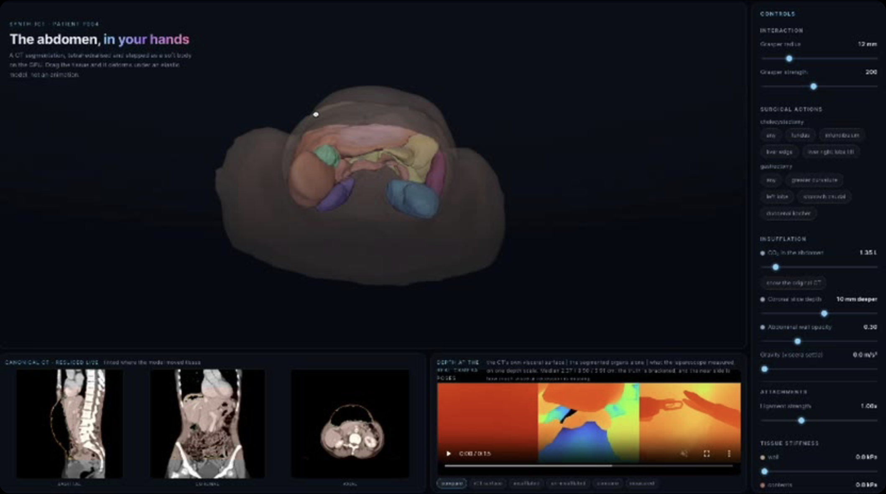
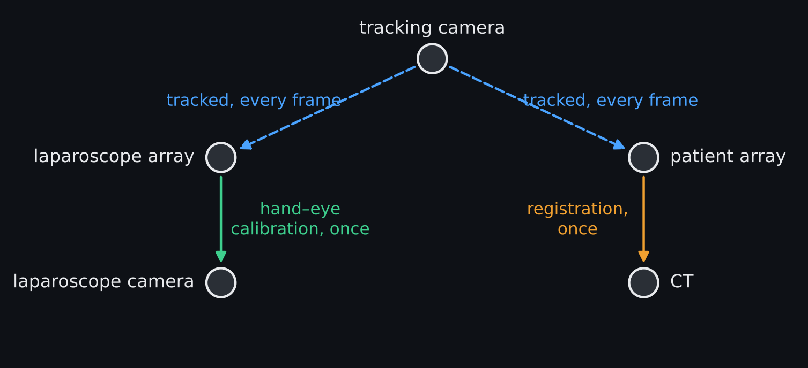
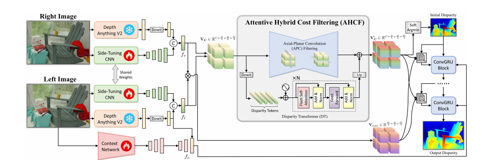
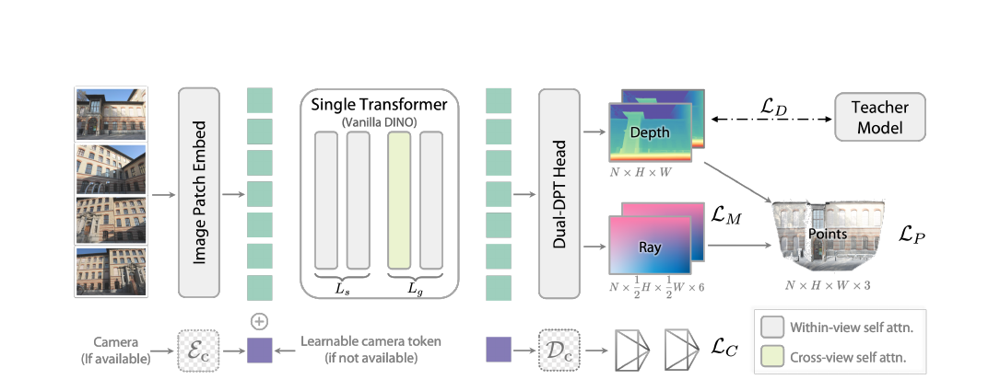

<!-- _class: title -->
<!-- _paginate: false -->

AI in Surgery · WS 26/27 · Kick-off

# Simulating Insufflation

From the pre-operative CT to the insufflated abdomen, tuned with laparoscopic video

Adrian Nikaeen &nbsp;·&nbsp; Boldizsar Horvath &nbsp;·&nbsp; Daria Rekretiuk &nbsp;·&nbsp; Emilian Denkov

Tutor: Maximilian Fehrentz &nbsp;&nbsp;|&nbsp;&nbsp; 27.11.2026

<!--
- The project: simulate how the abdomen changes under insufflation, and use the laparoscope video to make that simulation patient-specific.
-->

<!-- HIDDEN SLIDE (problem statement). To show it again: delete this line and the closing line below, and put "---" back in front of "# Problem statement".

# Problem statement

- Before laparoscopy the abdomen is **insufflated with CO₂**.
- The **abdominal wall lifts** and the **organs shift by centimetres**.
- The **pre-op CT** was taken **before** that: it no longer matches the patient on the table.
- In patients there is **no post-insufflation CT**: we don't know the insufflated anatomy.

<strong>Our idea:</strong> simulate the insufflation from the pre-op CT, and use the laparoscopic video to make it patient-specific.

[notes:
- Insufflation inflates the abdomen with gas so the surgeon has room to work. The wall lifts and the organs move by centimetres.
- Everything we know about the patient comes from the CT taken before that, so it shows the wrong shape.
- And in patients nobody takes a second CT after insufflation, so the real insufflated anatomy is unknown.
]

END OF HIDDEN SLIDE -->

---

Problem

# Insufflation reshapes the abdomen

<video src="assets/insufflation.mp4" poster="assets/insufflation_poster.png" autoplay muted playsinline></video>

<h3>Our goal</h3>

Predict the insufflated anatomy from the pre-op CT, then make it patient-specific with the laparoscope video.

<!--
- Surgery is planned on the pre-operative CT, which is taken without gas.
- In the OR a Veress needle goes in at the umbilicus and CO2 is blown into the gap between the abdominal wall and the organs. Then the needle comes out and the first trocar keeps the pressure at 12 to 15 mmHg.
- The wall lifts by several centimetres. The organs are pushed down. The back lies on the table and stays fixed.
- So the pre-op CT (dashed line) no longer matches the patient. Planned trocar positions and wall vessels are off.
- And in patients nobody takes a second CT after insufflation, so the real insufflated anatomy is unknown. (Only for our pigs we have one.)
- Our goal: simulate the insufflation from the pre-op CT, and use the laparoscope video to make it patient-specific.
-->

---
# Motivation

**Why simulate?**
- **Predict the insufflated anatomy** from the pre-op CT, where no second scan exists.
- **Keep navigation and planning valid:** CT-based overlays and port placement after insufflation.
- **Tool-tissue interaction:**

<!--

-->

---

Starting point &amp; research questions

# Where we start, where we go

<b>Where we start:</b> interactive insufflation simulator in NVIDIA Newton

pre-op CTsimulated, 12 mmHg

<b>What exists</b>A pressure-driven soft-tissue simulation of the abdomen in Newton, with many open issues.

<b class="hl">Ground truth</b>The real post-insufflation CTs of our 16&nbsp;pigs.

<b class="gas">Where we go</b>A simulation that approximates the real insufflation.

### Questions to answer

- How does soft-tissue simulation work, and which methods are relevant?
- How far can we get modelling tissue properties, attachment points and the abdominal wall, using only our existing semantics and agents?

<!--
- Starting point: Max's interactive insufflation simulator in NVIDIA Newton. A pressure-driven soft-tissue skeleton exists, with many open issues.
- Example: a human pre-op CT and the simulated state at 12 mmHg.
- Ground truth for us: the real post-insufflation CTs of the 16 pigs.
- Questions: how does soft-tissue simulation work and which methods matter? How far do we get with tissue properties, attachment points and the abdominal wall using only the segmentations and agents we already have?
- Transition: the next slides show how Bano et al. 2012 did this, which is our starting baseline.
-->

---
# Literature: FEM simulation and DejaVu

Pair A

**Placeholder for Pair A's slide**

- How FEM works (high level → the maths)
- DejaVu: simulation set up and combined with a real surgical image [1]
- Material point method vs. FEM, EndoGSim as an example

[1] Haouchine et al., DejaVu: Intra-operative Simulation for Surgical Gesture Rehearsal, MICCAI 2017

---
# Literature: simulating insufflation

Pair A

**Placeholder for Pair A's slide**

- Bano et al.: how pneumoperitoneum is modelled and validated [1]
- Anatomy: where the gas enters, which cavity unfolds, which organs sit inside or behind the peritoneum

[1] Bano et al., Simulation of Pneumoperitoneum for Laparoscopic Surgery Planning, MICCAI 2012

---

3D vision · our data

# Two kinds of video: mono pigs, stereo humans

The simulation predicts the insufflated shape. The video shows the real one, but only what the camera sees. What we can measure depends on the camera.

<h3>Porcine · 16 procedures</h3>

Visual from the cluster: one laparoscope frame, next to the post-insufflation CT surface with the tracked camera path

- **Mono** laparoscope, tracked
- CT **before and after** insufflation
- One camera: depth only **up to scale**
- Ground truth: the post-insufflation CT

<h3>Human · 3 cases, more coming</h3>

Visual from the cluster: one left/right stereo pair, next to the pre-op CT surface with the tracked camera path

- **Stereo** laparoscope, tracked (robotic and conventional)
- Pre-op CT only
- Two cameras: **metric** depth
- No ground truth: qualitative check only

<!--
- Transition from the simulation part: the simulation gives a prediction of the insufflated abdomen. The video is our only observation of the real one, inside the patient, but only of the surface the camera sees.
- Porcine: 16 procedures, one camera. From one camera you can't tell a small, near scene from a large, far one, so the depth has no absolute scale. But we have the CT after insufflation, so we can check our reconstruction against the real shape.
- Human: 3 cases so far, stereo. Two cameras a known distance apart give depth in millimetres directly. But there is no CT after insufflation, so we can only check the result qualitatively.
- Both are tracked. The next slide shows what that gives us.
-->

---

3D vision · from video to the CT

# Putting the video into the CT

<!-- TODO: add or swap in the tracking photo from Max's slides -->

$$P_{CT} = R^{\top}\big(Z\,K^{-1}p - t\big)$$

1. The **tracker** follows marker arrays on the laparoscope and on the patient
2. With **calibration** and **registration**, that gives the camera pose in the CT for every frame
3. So every pixel is a **ray** in the CT

Known: where the camera is and where each pixel looks. <strong>Missing: how far along the ray the tissue is, the depth Z.</strong>

<!--
- The optical tracker is an infrared stereo camera. It sees the marker arrays (3 to 4 reflective balls) on the laparoscope and on the patient, and reports their pose.
- Two links are fixed and measured once: hand-eye calibration (marker array to camera tip) and registration (CT to patient array). Two links are tracked every frame. Multiplying along the graph gives the camera pose in the CT:
  T_cam<-CT = T_cam<-lap · T_lap<-trk · T_trk<-pat · T_pat<-CT
- The formula, right to left: p = (u, v, 1) is the pixel. K⁻¹p undoes the lens and gives the ray direction. Z·K⁻¹p walks to depth Z along it, which is the point in camera coordinates in mm. −t and Rᵀ undo the camera pose (Rᵀ = R⁻¹), which gives the point in the CT.
- The tracker sees only the marker arrays, not the tissue. The insufflation is invisible to it, so the depth has to come from the video.
- First practical step: project the post-insufflation CT into the porcine video. If it lines up, the chain is right before any depth network is involved.
-->

---

3D vision · methods

# Methods: getting the depth

  

  
<b>FoundationStereo</b> [1] human · stereo

  
<b>Depth Anything 3</b> [2] porcine · mono

  

  

  

  
Input

  
rectified left + right image

  
one or many frames, optionally with K and the tracked poses

  
Output

  
disparity d per pixel → depth Z = f·B / d, in mm

  
depth + ray per pixel, consistent across frames, scale unknown

  
How we use it

  
unproject with the tracked pose → metric point cloud in the CT

  
scale from the tracked camera motion → point cloud in the CT, checked against the post-insufflation CT

<strong>With these methods today:</strong> the visible surface, per frame, in CT coordinates. <strong>Not yet:</strong> one consistent surface over time, or anything the camera doesn't see.

[1] Wen et al., FoundationStereo: Zero-Shot Stereo Matching, CVPR 2025 · [2] Lin et al., Depth Anything 3: Recovering the Visual Space from Any Views, arXiv 2025

<!--
- Both are pretrained and used as they are, zero-shot. We don't train them.
- FoundationStereo: the same point appears shifted by d pixels between the left and right image. With focal length f and baseline B (distance between the two cameras) the depth is Z = f·B/d, directly in mm. It runs per frame. Figure: features from both images, a cost volume that compares every possible shift, then iterative refinement of the disparity.
- Depth Anything 3: one transformer looks at all frames together, so the depths agree across views. It predicts a depth map and a ray map per frame; a 3D point is ray origin + depth × direction. Our tracked poses can be given as input. From one camera the scale is unknown; the tracked camera motion is in mm, which fixes it.
- Then the same step for both: the formula from the previous slide puts every pixel into the CT.
- What we get today is the surface the camera sees, frame by frame. Turning that into one surface to compare with the simulation is the open question on the next slide.
-->

<!-- BridgeSplat moved to Pair A (supervisor feedback, 25.11). The full explanation is in slides.md, part 4. -->

---
# Proposed solution

Simulation (Pair A)

<b>Pre-op CT</b>porcinehuman

→

<b>FEM insufflation</b>Bano et al. [1]

→

<b>Simulated surface</b>insufflated, in CT coordinates

<b>⇅ Compare</b> in CT coordinates, where the camera saw → <b>tune simulation parameters</b>

→

<b>Evaluate</b> vs. post-insufflation CT porcine

Video (Pair B)

<b>Tracked video</b>porcine: monohuman: stereo

→

<b>Depth</b>DA3 [2] porcine FoundationStereo [3] human

→

<b>Reconstruction ?</b>open question, see below

→

<b>Reconstructed surface</b>in CT coordinates

**Open question, and our main challenge:** how do we turn per-frame depth into one surface to compare with the simulation?
- **Fuse:** unproject all frames with the tracked poses into one point cloud. Simple, but it assumes nothing moves.
- **Build a mesh** from the fused points and compare surface to surface.
- **Fit a mesh:** deform the pre-op CT or the simulated mesh until it matches the depth, as in BridgeSplat [4]. This keeps the correspondence with the simulation.

[1] Bano et al., MICCAI 2012 · [2] Lin et al., Depth Anything 3, arXiv 2025 · [3] Wen et al., FoundationStereo, CVPR 2025 · [4] Fehrentz et al., BridgeSplat, MICCAI 2025

<!--
- Top: Pair A simulates the insufflation from the pre-op CT, following Bano et al.
- Bottom: we reconstruct the real insufflated surface from the tracked video: depth from DA3 on porcine and FoundationStereo on human, put into the CT with the tracked poses.
- How exactly we get from per-frame depth to one surface is still open. That is the main challenge on our side. Three options: fuse all frames into one point cloud (simple, but the scene changes while the gas comes in); build a mesh from it; or deform a mesh (pre-op CT or the simulated one) to match the depth, as in BridgeSplat, which keeps the vertex-to-vertex correspondence with the simulation.
- Both meet in CT coordinates. The mismatch tunes the simulation's parameters, and on the porcine data we evaluate against the real post-insufflation CT, with and without the video refinement.
- The video only sees part of the surface, so the comparison counts only the region the camera saw. The physics then carries the correction to the parts it can't see (e.g. wall too stiff → lower stiffness → organs behind move too).
- Humans have no post-insufflation CT; the only check there is that the tracked camera must lie inside the gas, not inside tissue.
-->

<!-- HIDDEN SLIDE (old timeline). To show it again: delete this line and the closing line below, and put "---" back in front of "# Project timeline".

# Project timeline

| Step | Simulation (Pair A) | Video (Pair B) |
|---|---|---|
| Now | get to know the dataset | get to know the dataset; video ↔ CT visualizer; first DA3 tests, unproject into the CT |
| 1 · Porcine | reproduce Bano et al. [1], benchmark across all 16 pigs | depth per frame (DA3 + scale), checked against the post-insufflation CT |
| 2 · Human | apply to the human cases (qualitative) | stereo depth with FoundationStereo |
| 3 · Refine | ⇄ tune the simulation parameters to the video reconstruction | reconstruct the early minutes of surgery (porcine + human) |
| 4 · Evaluate | porcine: simulation **with vs. without** video refinement against the post-insufflation CT | |

<strong>Interface:</strong> agree early on the coordinate frame (CT) and mesh format, so step 3 can start as soon as both sides are ready.

[1] Bano et al., Simulation of Pneumoperitoneum for Laparoscopic Surgery Planning, MICCAI 2012

[notes:
- Right now both pairs get to know the data. On the video side: a video-to-CT visualizer and first DA3 tests.
- Steps 1 and 2 run in parallel: the simulation is reproduced on the pigs and then the humans; depth is built and checked against the porcine post-insufflation CT.
- Step 3 is where the two parts meet. Step 4 measures whether the video refinement helps, on the pigs.
]

END OF HIDDEN SLIDE -->

---

Timeline &amp; organisation

# Plan

<b>Course frame:</b> 16.10 pitches · 19.10 matching · Nov OR visits · 27.11 kick-off presentations · mid–late Jan final presentations (before exam season, Prof. Navab attends)

  

Nov

Dec I

Dec II

Jan I

Jan II

  
Simulation

  
Reading: FEM, Bano, DejaVu

  
Bano setup on 1 pig

  
Benchmark 16 pigs

  
Improve + human cases

  

  
3D vision

  
Reading: BridgeSplat, DA3

  
Video↔CT visualizer, DA3 tests

  
Reconstruct early minutes

  

  
Together

  

  
Tune sim to video

  
Evaluate + final pres.

  
holidays

  
early NovProject start

  
27.11Kick-off pres.

  
mid DecBano baseline runs

  
early Jan16-pig benchmark

  
mid–late JanFinal presentation

Owners: Simulation · Adrian, Daria &nbsp;|&nbsp; 3D vision · Boldizsar, Emilian &nbsp;|&nbsp; Interface: shared CT coordinate frame + surface meshes

<!--
- Course frame from Max: pitches mid October, matching, OR visits in November, kick-off presentations now, final presentations mid to late January before exam season.
- We started in early November with the reading.
- December: Bano baseline on one pig, then the benchmark over all 16 pigs. In parallel the vision side builds a video-to-CT visualizer and tests depth estimation.
- January: improve the simulation and try the human cases, reconstruct the first minutes of surgery from video, tune the simulation to it, evaluate with and without video, final presentation.
-->

---
# Conclusion

- **Problem:** insufflation moves the anatomy by centimetres, and in patients there is no post-insufflation CT
- **Simulation:** predict the insufflated anatomy from the pre-op CT, validated on 16 porcine procedures
- **Video:** reconstruct the real insufflated surface in CT coordinates and use it to tune the simulation
- **Goal:** a patient-specific insufflation model, and a first step towards physics simulation + 3D vision for harder cases (tool–tissue interaction, dissection)

<strong>Key question:</strong> does refining the simulation with video bring it closer to the real post-insufflation CT?

<!--
- To sum up: we simulate what we can't scan, and use what we can see to make it patient-specific. The pigs tell us whether that works. Thanks, happy to take questions.
-->

---
<!-- footer: "" -->

# References

- Bano, J. et al. Simulation of Pneumoperitoneum for Laparoscopic Surgery Planning. MICCAI 2012.
- Haouchine, N. et al. DejaVu: Intra-operative Simulation for Surgical Gesture Rehearsal. MICCAI 2017.
- Hartley, R., Zisserman, A. Multiple View Geometry in Computer Vision, 2nd ed. Cambridge University Press, 2004.
- Wen, B. et al. FoundationStereo: Zero-Shot Stereo Matching. CVPR 2025. arXiv:2501.09898
- Lin, H. et al. Depth Anything 3: Recovering the Visual Space from Any Views. arXiv:2511.10647, 2025.
- Fehrentz, M. et al. BridgeSplat: Bidirectionally Coupled CT and Non-Rigid Gaussian Splatting for Deformable Intraoperative Surgical Navigation. MICCAI 2025. arXiv:2509.18501
- Kerbl, B. et al. 3D Gaussian Splatting for Real-Time Radiance Field Rendering. ACM TOG (SIGGRAPH) 2023.

---
<!-- _paginate: false -->

Backup · Literature · Simulation

# Beyond Bano

| | What it does | What is missing for us |
|---|---|---|
| **Bano et al.** MICCAI 2012 | FEM insufflation from the pre-op CT with measured tissue values | No video. Only 2 pigs, one material for all organs |
| **DejaVu** MICCAI 2017 | FEM organ model (SOFA) registered to one laparoscopic frame, deformation rendered into the real image | Manual rigid 3D/2D registration. Insufflation deformation named as open problem |
| **MPM** e.g. EndoGSim | Material carried by particles, physics on a background grid. No mesh to build | Different trade-off vs. FEM, fits Gaussian splats from video |

Bano: physics without video &nbsp;·&nbsp; DejaVu: video with rigid registration &nbsp;·&nbsp; us: physics tuned by video

<!--
BACKUP, only if asked how our project differs from the literature.
- Bano (Bano et al.): FEM insufflation from the pre-op CT, but no video and only 2 pigs.
- DejaVu (Haouchine et al.): pre-op mesh + physical model in SOFA, manually registered to a single intra-op image. Its discussion says the registration has to handle the large deformation from insufflation pressure, and that patient-specific parameters are an open challenge. That is our gap.
- MPM: particles instead of a mesh, EndoGSim as an example.
-->

---
<!-- _paginate: false -->

Backup · 3D vision · beyond our scope

# If it works: what comes later

- **Continuous alignment:** keep the CT-based simulation and the video aligned through the whole surgery, not only at the start
- **Instruments in 3D:** reconstruct the tools from depth + segmentation
- **Tool–tissue interaction:** feed what the tools do to the tissue into the simulation
- **Beyond the visible:** estimate how tissue the camera can't see deforms

<strong>Our scope:</strong> insufflation only. Depth of the visible surface in CT coordinates, compared with the simulation and, on the pigs, with the post-insufflation CT.

<!--
BACKUP, only if asked where this leads.
- None of this is part of our project. It's where the group wants to go if aligning simulation and video works for insufflation.
- Instruments: depth gives where the tool surface is, segmentation says which pixels are the tool.
- Beyond the visible: the simulation links what the camera sees to what it doesn't, so a correction in the visible part also moves the hidden part.
-->
