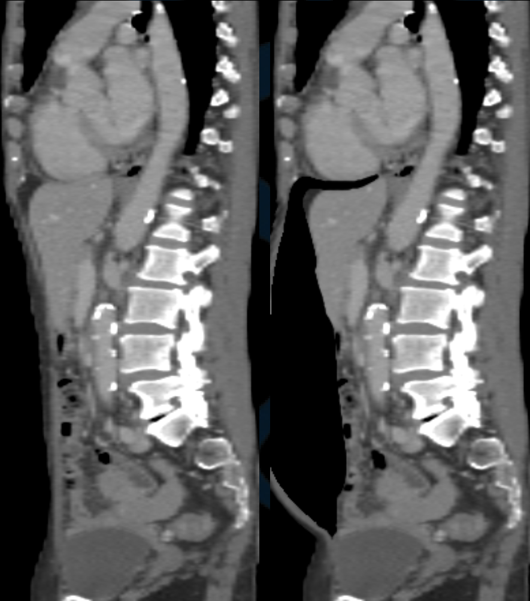

<!-- _class: title -->
<!-- _paginate: false -->

AI in Surgery · WS 26/27 · Kick-off

# Simulating Insufflation

From the pre-operative CT to the insufflated abdomen, tuned with laparoscopic video

Adrian Nikaeen &nbsp;·&nbsp; Boldizsar Horvath &nbsp;·&nbsp; Daria Rekretiuk &nbsp;·&nbsp; Emilian Denkov

Tutor: Maximilian Fehrentz &nbsp;&nbsp;|&nbsp;&nbsp; 27.11.2026

<!--
- The project: simulate how the abdomen changes under insufflation, and use the laparoscope video to make that simulation patient-specific.
-->

<!-- HIDDEN SLIDE (problem statement). To show it again: delete this line and the closing line below, and put "---" back in front of "# Problem statement".

# Problem statement

- Before laparoscopy the abdomen is **insufflated with CO₂**.
- The **abdominal wall lifts** and the **organs shift by centimetres**.
- The **pre-op CT** was taken **before** that: it no longer matches the patient on the table.
- In patients there is **no post-insufflation CT**: we don't know the insufflated anatomy.

<strong>Our idea:</strong> simulate the insufflation from the pre-op CT, and use the laparoscopic video to make it patient-specific.

[notes:
- Insufflation inflates the abdomen with gas so the surgeon has room to work. The wall lifts and the organs move by centimetres.
- Everything we know about the patient comes from the CT taken before that, so it shows the wrong shape.
- And in patients nobody takes a second CT after insufflation, so the real insufflated anatomy is unknown.
]

END OF HIDDEN SLIDE -->

---

Problem

# Insufflation reshapes the abdomen

<video src="assets/insufflation.mp4" poster="assets/insufflation_poster.png" autoplay muted playsinline></video>

<h3>Our goal</h3>

Predict the insufflated anatomy from the pre-op CT, then make it patient-specific with the laparoscope video.

<!--
- Surgery is planned on the pre-operative CT, which is taken without gas.
- In the OR a Veress needle goes in at the umbilicus and CO2 is blown into the gap between the abdominal wall and the organs. Then the needle comes out and the first trocar keeps the pressure at 12 to 15 mmHg.
- The wall lifts by several centimetres. The organs are pushed down. The back lies on the table and stays fixed.
- So the pre-op CT (dashed line) no longer matches the patient. Planned trocar positions and wall vessels are off.
- And in patients nobody takes a second CT after insufflation, so the real insufflated anatomy is unknown. (Only for our pigs we have one.)
- Our goal: simulate the insufflation from the pre-op CT, and use the laparoscope video to make it patient-specific.
-->

---
# Motivation

**Why simulate?**
- **Predict the insufflated anatomy** from the pre-op CT, where no second scan exists.
- **Keep navigation and planning valid:** CT-based overlays and port placement after insufflation.
- **Tool-tissue interaction:**

<!--

-->

---

Starting point &amp; research questions

# Where we start, where we go

<b>Where we start:</b> interactive insufflation simulator in NVIDIA Newton

pre-op CTsimulated, 12 mmHg

<b>What exists</b>A pressure-driven soft-tissue simulation of the abdomen in Newton, with many open issues.

<b class="hl">Ground truth</b>The real post-insufflation CTs of our 16&nbsp;pigs.

<b class="gas">Where we go</b>A simulation that approximates the real insufflation.

### Questions to answer

- How does soft-tissue simulation work, and which methods are relevant?
- How far can we get modelling tissue properties, attachment points and the abdominal wall, using only our existing semantics and agents?

<!--
- Starting point: Max's interactive insufflation simulator in NVIDIA Newton. A pressure-driven soft-tissue skeleton exists, with many open issues.
- Example: a human pre-op CT and the simulated state at 12 mmHg.
- Ground truth for us: the real post-insufflation CTs of the 16 pigs.
- Questions: how does soft-tissue simulation work and which methods matter? How far do we get with tissue properties, attachment points and the abdominal wall using only the segmentations and agents we already have?
- Transition: the next slides show how Bano et al. 2012 did this, which is our starting baseline.
-->

---
# Literature: FEM simulation and DejaVu

Pair A

**Placeholder for Pair A's slide**

- How FEM works (high level → the maths)
- DejaVu: simulation set up and combined with a real surgical image [1]
- Material point method vs. FEM, EndoGSim as an example

[1] Haouchine et al., DejaVu: Intra-operative Simulation for Surgical Gesture Rehearsal, MICCAI 2017

---
# Literature: simulating insufflation

Pair A

**Placeholder for Pair A's slide**

- Bano et al.: how pneumoperitoneum is modelled and validated [1]
- Anatomy: where the gas enters, which cavity unfolds, which organs sit inside or behind the peritoneum

[1] Bano et al., Simulation of Pneumoperitoneum for Laparoscopic Surgery Planning, MICCAI 2012

---
# Literature: from video pixels to the CT

$$P_{CT} = R^{\top}\big(Z\,K^{-1}p - t\big)$$

- **Optical tracker:** IR stereo camera, sees reflective *marker arrays* (3–4 balls in a known pattern) → their 6 DOF pose
- **Registration:** CT ↔ patient array. Multiply along the graph → *CT → camera*, per frame
- **FoundationStereo [1]:** stereo, zero-shot → **metric** depth (human)
- **Depth Anything 3 [2]:** mono → depth **up to scale**; tracked poses fix the scale (porcine)

[1] Wen et al., FoundationStereo: Zero-Shot Stereo Matching, CVPR 2025 · [2] Lin et al., Depth Anything 3, arXiv 2025

<!--
- The optical tracker sees marker arrays on the laparoscope and the patient. With calibration and registration this gives us, every frame, where the camera is in the CT.
- So each pixel becomes a ray in the CT; we only miss the depth along it.
- FoundationStereo gives metric depth from the stereo laparoscope in the human cases. Depth Anything 3 gives depth from mono video, but only up to scale, which we fix with the tracked camera motion on the porcine data.
- The tracker sees only the marker arrays, not the anatomy: the insufflation is invisible to it.

-->

---
# Literature: reconstruction with DA3 and BridgeSplat

**Depth Anything 3 [1]**
- Takes all frames of a video at once and predicts a depth map and a ray map for each; origin + depth × direction gives a 3D point per pixel, so all frames fuse into one point cloud.
- With our tracked poses as input and the scale fixed in mm, that point cloud is the insufflated surface directly in CT coordinates.

**BridgeSplat [2]** (figure above)
- A monocular, non-rigid reconstruction method for laparoscopic video.
- It would be used to register our patient/porcine data for our alignment with the simulation.
- Same setup as our porcine data: **CT + tracked monocular laparoscope video**

[1] Lin et al., Depth Anything 3: Recovering the Visual Space from Any Views, arXiv 2025 · [2] Fehrentz et al., BridgeSplat: Bidirectionally Coupled CT and Non-Rigid Gaussian Splatting for Deformable Intraoperative Surgical Navigation, MICCAI 2025

<!--
- BridgeSplat works on exactly our kind of data. It builds a mesh from the CT, attaches Gaussian splats to it, and renders each frame from the tracked pose.
- Since the pose is known and the Gaussians can't leave the mesh, the only way to match the video is to deform the mesh. That deformed mesh is the real tissue shape in CT coordinates.

How BridgeSplat works (briefly):
- Initialisation: segment the CT into a surface mesh and register it rigidly into the tracker frame. Attach flat 3D Gaussians to the mesh triangles: position fixed by barycentric coordinates, rotation fixed to the triangle normal; only the two in-plane scales, opacity and colour are learned.
- First frame: render, find which Gaussians are visible, and pick anchor vertices among them. Each anchor gets a learnable displacement; all other vertices are interpolated from the anchors (the deformation field).
- Every frame: deform the mesh → the Gaussians move with it → render from the tracked pose → compare with the real frame (photometric loss, surgical tools masked out) → gradients flow back to the anchor displacements.
- Regulariser: ARAP (as-rigid-as-possible) lets local patches rotate but not stretch, which keeps the deformation plausible where one camera sees little.
- Result: the fitted deformation is carried back to the CT, so the CT follows the tissue ("bidirectionally coupled").

How Depth Anything 3 works (briefly):
- Input: any number of frames, with or without camera poses. Known poses (our tracking) can be fed in through a camera token.
- Backbone: a plain DINOv2 transformer. The first 2/3 of the layers attend within each image; the last 1/3 alternate between within-image and across all frames. That cross-frame attention is what makes the views consistent with each other.
- Head (dual-DPT): one shared feature reassembly, then two branches: a depth map and a ray map (per pixel the ray origin + direction). 3D point = origin + depth × direction.
- Training: a teacher trained only on synthetic data gives sharp, complete depth; it is aligned to noisy real depth (scale + shift fit) to make pseudo-labels for the multi-view student.
- Catch for us: the depth is only up to scale, so the metric scale comes from the tracked camera motion (or the CT, or stereo).

-->

---
# Proposed solution

Simulation (Pair A)

<b>Pre-op CT</b>porcinehuman

→

<b>FEM insufflation</b>Bano et al. [1]

→

<b>Simulated surface</b>insufflated, in CT coordinates

<b>⇅ Compare</b> in CT coordinates → <b>tune simulation parameters</b>

→

<b>Evaluate</b> vs. post-insufflation CT porcine

Video (Pair B)

<b>Tracked video</b>porcine: monohuman: stereo

→

<b>Depth</b>DA3 [2] porcine FoundationStereo [3] human

→

<b>BridgeSplat [4]</b>deform the CT mesh to match the video

→

<b>Reconstructed surface</b>in CT coordinates

[1] Bano et al., MICCAI 2012 · [2] Lin et al., Depth Anything 3, arXiv 2025 · [3] Wen et al., FoundationStereo, CVPR 2025 · [4] Fehrentz et al., BridgeSplat, MICCAI 2025

<!--
- Top: Pair A simulates the insufflation from the pre-op CT, following Bano et al.
- Bottom: we reconstruct the real insufflated surface from the tracked video: depth from DA3 on porcine and FoundationStereo on human, then BridgeSplat deforms the CT mesh to match.
- Both meet in CT coordinates. The mismatch tunes the simulation's parameters, and on the porcine data we evaluate against the real post-insufflation CT, with and without the video refinement.
-->

<!-- HIDDEN SLIDE (old timeline). To show it again: delete this line and the closing line below, and put "---" back in front of "# Project timeline".

# Project timeline

| Step | Simulation (Pair A) | Video (Pair B) |
|---|---|---|
| Now | get to know the dataset | get to know the dataset; video ↔ CT visualizer; first DA3 tests, unproject into the CT |
| 1 · Porcine | reproduce Bano et al. [1], benchmark across all 16 pigs | depth per frame (DA3 + scale), checked against the post-insufflation CT |
| 2 · Human | apply to the human cases (qualitative) | stereo depth with FoundationStereo |
| 3 · Refine | ⇄ tune the simulation parameters to the video reconstruction | reconstruct the early minutes of surgery (porcine + human) |
| 4 · Evaluate | porcine: simulation **with vs. without** video refinement against the post-insufflation CT | |

<strong>Interface:</strong> agree early on the coordinate frame (CT) and mesh format, so step 3 can start as soon as both sides are ready.

[1] Bano et al., Simulation of Pneumoperitoneum for Laparoscopic Surgery Planning, MICCAI 2012

[notes:
- Right now both pairs get to know the data. On the video side: a video-to-CT visualizer and first DA3 tests.
- Steps 1 and 2 run in parallel: the simulation is reproduced on the pigs and then the humans; depth is built and checked against the porcine post-insufflation CT.
- Step 3 is where the two parts meet. Step 4 measures whether the video refinement helps, on the pigs.
]

END OF HIDDEN SLIDE -->

---

Timeline &amp; organisation

# Plan

<b>Course frame:</b> 16.10 pitches · 19.10 matching · Nov OR visits · 27.11 kick-off presentations · mid–late Jan final presentations (before exam season, Prof. Navab attends)

  

Nov

Dec I

Dec II

Jan I

Jan II

  
Simulation

  
Reading: FEM, Bano, DejaVu

  
Bano setup on 1 pig

  
Benchmark 16 pigs

  
Improve + human cases

  

  
3D vision

  
Reading: BridgeSplat, DA3

  
Video↔CT visualizer, DA3 tests

  
Reconstruct early minutes

  

  
Together

  

  
Tune sim to video

  
Evaluate + final pres.

  
holidays

  
early NovProject start

  
27.11Kick-off pres.

  
mid DecBano baseline runs

  
early Jan16-pig benchmark

  
mid–late JanFinal presentation

Owners: Simulation · Adrian, Daria &nbsp;|&nbsp; 3D vision · Boldizsar, Emilian &nbsp;|&nbsp; Interface: shared CT coordinate frame + surface meshes

<!--
- Course frame from Max: pitches mid October, matching, OR visits in November, kick-off presentations now, final presentations mid to late January before exam season.
- We started in early November with the reading.
- December: Bano baseline on one pig, then the benchmark over all 16 pigs. In parallel the vision side builds a video-to-CT visualizer and tests depth estimation.
- January: improve the simulation and try the human cases, reconstruct the first minutes of surgery from video, tune the simulation to it, evaluate with and without video, final presentation.
-->

---
# Conclusion

- **Problem:** insufflation moves the anatomy by centimetres, and in patients there is no post-insufflation CT
- **Simulation:** predict the insufflated anatomy from the pre-op CT, validated on 16 porcine procedures
- **Video:** reconstruct the real insufflated surface in CT coordinates and use it to tune the simulation
- **Goal:** a patient-specific insufflation model, and a first step towards physics simulation + 3D vision for harder cases (tool–tissue interaction, dissection)

<strong>Key question:</strong> does refining the simulation with video bring it closer to the real post-insufflation CT?

<!--
- To sum up: we simulate what we can't scan, and use what we can see to make it patient-specific. The pigs tell us whether that works. Thanks, happy to take questions.
-->

---
<!-- footer: "" -->

# References

- Bano, J. et al. Simulation of Pneumoperitoneum for Laparoscopic Surgery Planning. MICCAI 2012.
- Haouchine, N. et al. DejaVu: Intra-operative Simulation for Surgical Gesture Rehearsal. MICCAI 2017.
- Hartley, R., Zisserman, A. Multiple View Geometry in Computer Vision, 2nd ed. Cambridge University Press, 2004.
- Wen, B. et al. FoundationStereo: Zero-Shot Stereo Matching. CVPR 2025. arXiv:2501.09898
- Lin, H. et al. Depth Anything 3: Recovering the Visual Space from Any Views. arXiv:2511.10647, 2025.
- Fehrentz, M. et al. BridgeSplat: Bidirectionally Coupled CT and Non-Rigid Gaussian Splatting for Deformable Intraoperative Surgical Navigation. MICCAI 2025. arXiv:2509.18501
- Kerbl, B. et al. 3D Gaussian Splatting for Real-Time Radiance Field Rendering. ACM TOG (SIGGRAPH) 2023.

---
<!-- _paginate: false -->

Backup · Literature · Simulation

# Beyond Bano

| | What it does | What is missing for us |
|---|---|---|
| **Bano et al.** MICCAI 2012 | FEM insufflation from the pre-op CT with measured tissue values | No video. Only 2 pigs, one material for all organs |
| **DejaVu** MICCAI 2017 | FEM organ model (SOFA) registered to one laparoscopic frame, deformation rendered into the real image | Manual rigid 3D/2D registration. Insufflation deformation named as open problem |
| **MPM** e.g. EndoGSim | Material carried by particles, physics on a background grid. No mesh to build | Different trade-off vs. FEM, fits Gaussian splats from video |

Bano: physics without video &nbsp;·&nbsp; DejaVu: video with rigid registration &nbsp;·&nbsp; us: physics tuned by video

<!--
BACKUP, only if asked how our project differs from the literature.
- Bano (Bano et al.): FEM insufflation from the pre-op CT, but no video and only 2 pigs.
- DejaVu (Haouchine et al.): pre-op mesh + physical model in SOFA, manually registered to a single intra-op image. Its discussion says the registration has to handle the large deformation from insufflation pressure, and that patient-specific parameters are an open challenge. That is our gap.
- MPM: particles instead of a mesh, EndoGSim as an example.
-->
