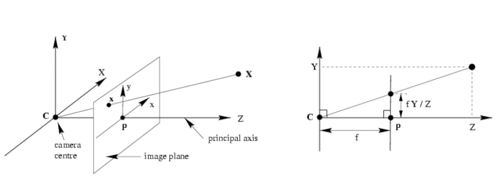
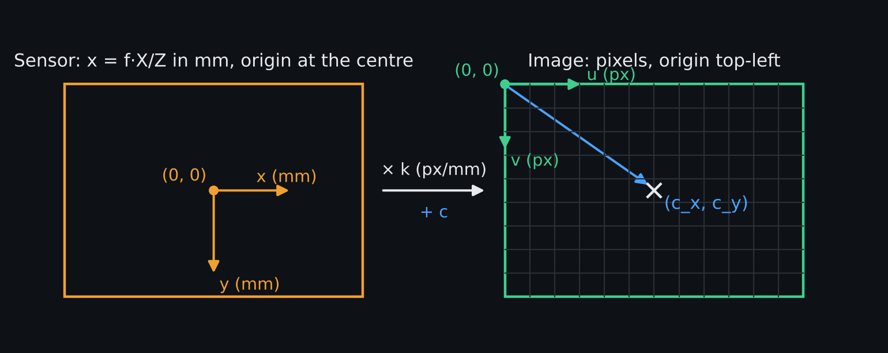
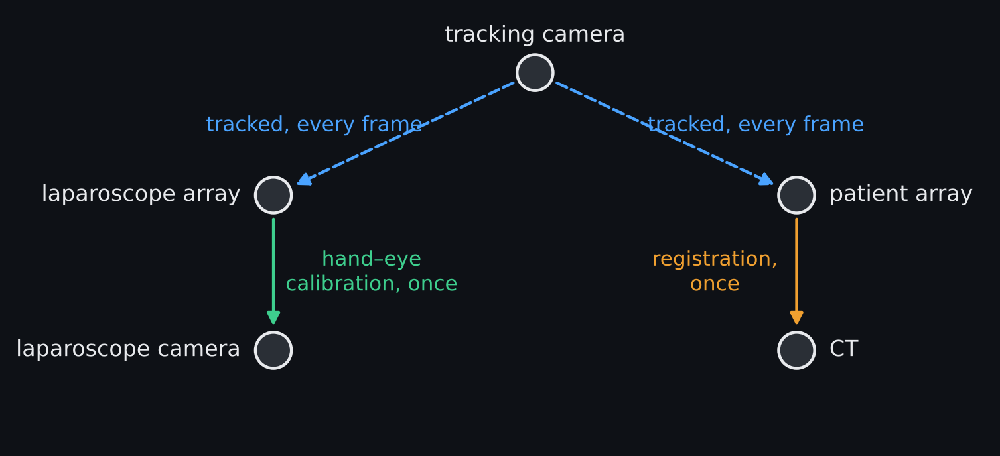
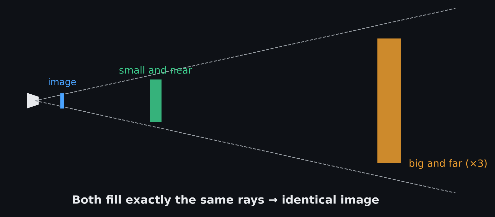
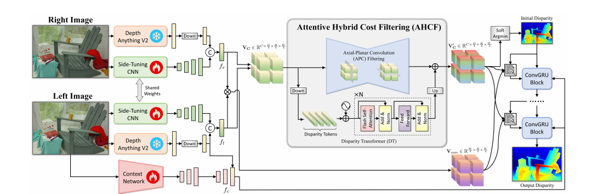
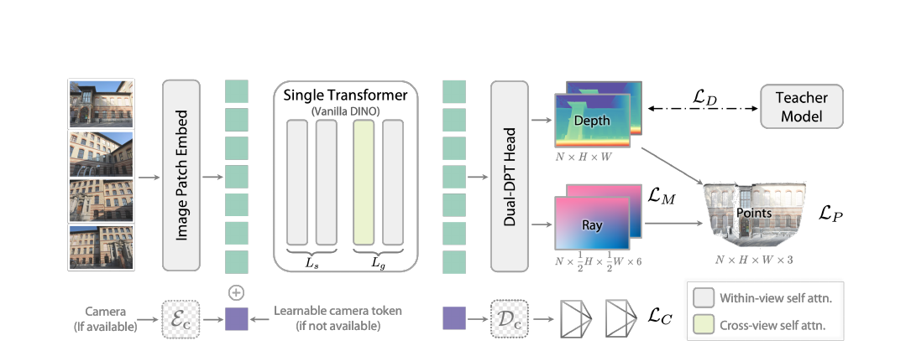
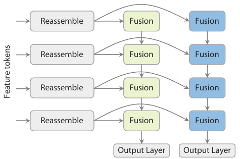
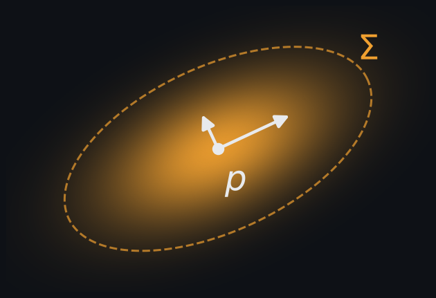
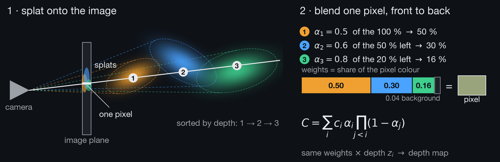
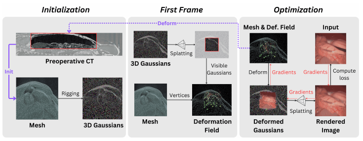

<!-- _class: title -->
<!-- _paginate: false -->

# From pixels to 3D

## Camera basics, stereo and monocular depth, BridgeSplat

 

Boldizsar and Emilian · AI in Surgery (CAMP, TUM) · Pair B

How laparoscope video becomes 3D points in the CT that we can compare with the insufflation simulation

<!--
- The simulation predicts the insufflated abdomen; the video sees the real one. This talk: how video pixels become 3D points in CT coordinates, so the two can be compared.
- Pair B covers camera geometry, depth from two cameras (FoundationStereo) and from one (Depth Anything 3), and BridgeSplat, which ties the video to the CT mesh.
-->

---
# Roadmap

1. **Camera basics:** a pixel is a ray; K and [R | t] take it into the CT. The only unknown is the depth Z
2. **Stereo depth:** two cameras turn Z into a pixel shift. FoundationStereo measures it zero-shot
3. **Monocular depth:** Depth Anything 3, depth and rays from any number of views
4. **BridgeSplat:** Gaussian splatting in brief; then CT mesh + tracked pose → only the tissue deformation is left to find
5. **Putting it together:** which tool for which data, and how the result is compared with the simulation

<strong>Goal of this project step:</strong> 3D geometry of the insufflated abdomen, in CT coordinates, from laparoscope video, to compare with the simulated insufflation.

<!--
- Each part ends with a "what this means for us" slide.
- Parts 2, 3 and 4 are three answers to the question part 1 ends with: where does Z come from? Two cameras, one camera with a learned prior, one camera with the CT as prior.
-->

---
<!-- _class: section -->
<!-- footer: "1 · Camera basics" -->

# 1 · Camera basics

A pixel is a ray. With K and [R | t] we can follow it into the CT; the depth Z along it is what's missing.

---
# The pinhole camera

Similar triangles (right): $\dfrac{y}{Y} = \dfrac{f}{Z}$, which gives

$$x = f\,\frac{X}{Z} \qquad\qquad y = f\,\frac{Y}{Z}$$

C = camera centre · f = focal length (C to image plane) · p = principal point. The real sensor is behind C (image upside down); we draw it in front so the image is upright, same maths. Figure: Hartley & Zisserman, Multiple View Geometry, Fig. 6.1.

<!--
- Camera centre C, image plane at distance f, the principal axis is Z.
- Right: side view. Similar triangles give y/Y = f/Z.
- x, y here are in mm on the sensor, origin at the principal point p. Pixels come two slides later.
-->

---
# Depth is lost in projection

$$x = f\,\frac{X}{Z}$$

We **divide by Z**: far things look smaller (perspective), and the depth disappears.

$$(X, Y, Z) \;\text{and}\; (2X, 2Y, 2Z) \;\to\; \text{the same pixel}$$

- One pixel = one **ray** from the camera, not one point
- Every point on that ray lands on the same pixel
- To get 3D back we need **Z from somewhere else**

<strong>Projection is many-to-one.</strong> Inverting it needs one extra number per pixel: the depth Z.

<!--
- A whole ray maps to one pixel, so from a single image there is no 3D.
- Everything later in the talk is a way to get Z back: a second camera (part 2), a learned prior (part 3), the CT mesh (part 4).
-->

---
# From mm on the sensor to pixels

1. **Scale:** $k_x, k_y$ pixels per mm → $u = k_x\, x$
2. **Shift:** the origin moves from the centre to the top-left corner → $+\,c_x, c_y$

$$u = f_x\,\frac{X}{Z} + c_x \qquad v = f_y\,\frac{Y}{Z} + c_y \qquad f_x = k_x f,\; f_y = k_y f$$

<!--
- k_x, k_y: pixel density. They differ if pixels are not square, which is why f_x and f_y are separate.
- c_x, c_y: where the principal axis hits the sensor, in pixels. Close to the image centre, but not exactly.
- f only ever appears multiplied by k: we never need f in mm, only f_x, f_y in pixels.
-->

---
# Intrinsics K, in homogeneous coordinates

$$
Z \begin{bmatrix} u \\ v \\ 1 \end{bmatrix}
=
\underbrace{\begin{bmatrix} f_x & 0 & c_x \\ 0 & f_y & c_y \\ 0 & 0 & 1 \end{bmatrix}}_{K}
\begin{bmatrix} X \\ Y \\ Z \end{bmatrix}
$$

- **Homogeneous trick:** append a 1, so the shift $c$ and the division by Z fit into one matrix
- **4 parameters** ($f_x, f_y, c_x, c_y$), fixed for a camera: they don't change when it moves
- Found once by **calibration**: images of a checkerboard of known size

<!--
- Multiply out the first row: Z·u = f_x·X + c_x·Z, so u = f_x·X/Z + c_x. Same as the previous slide.
- Some models add a skew entry K[0,1]; it is about 0 for modern sensors.
- Calibration (Zhang 2000): many checkerboard views, detect the corners, fit K and the distortion by minimising the reprojection error. Once per laparoscope, and again if focus or zoom changes.
-->

---
# Extrinsics [R | t]: where is the camera?

Points are known in the **world/CT**, but K needs them in **camera** coordinates.

$$P_{cam} = R\,P_{world} + t \qquad\qquad \left[\begin{matrix} P_{cam} \\ 1 \end{matrix}\right] = \left[\begin{matrix} R & t \\ 0\;\,0\;\,0 & 1 \end{matrix}\right] \left[\begin{matrix} P_{world} \\ 1 \end{matrix}\right]$$

- **R**: 3×3 rotation, **3 DOF**: rotate around x (pitch), y (yaw), z (roll)
- **t**: translation, **3 DOF**: along x, y, z
- → **6 DOF pose**, changes **every frame**

- 9 numbers in R, but only 3 free: columns orthonormal (6 constraints)
- Inverse of a rotation = transpose: $R^{-1} = R^{\top}$

<!--
- For us, "world" = CT coordinates.
- Where is the camera centre in the CT? Set P_cam = 0: C = −Rᵀt.
- The 4×4 form lets us chain transforms by multiplying matrices. That's how the OR tracking chain works (two slides on).
-->

---
# The full projection

$$
Z \begin{bmatrix} u \\ v \\ 1 \end{bmatrix} = K\,[R \mid t]
\begin{bmatrix} X_w \\ Y_w \\ Z_w \\ 1 \end{bmatrix}
$$

world point → **[R | t]** → camera point → **K** → divide by Z → pixel

| | Intrinsics K | Extrinsics [R \| t] |
|---|---|---|
| Describes | the camera itself (lens, sensor) | where the camera is and looks |
| Changes when the camera moves? | no | yes, every frame |
| Comes from | checkerboard calibration, once | tracking (or SLAM), every frame |

<!--
- K[R|t] is one 3×4 matrix: CT point to pixel in one multiplication, then divide by the third coordinate.
- SLAM would estimate [R|t] from the video itself. We get it from the optical tracker instead (next slide), which matters a lot for BridgeSplat.
-->

---
# Where K and [R | t] come from in the OR

$$T_{\text{cam}\leftarrow\text{CT}} = \underbrace{T_{\text{cam}\leftarrow\text{lap}}}_{\text{hand–eye}}\; \underbrace{T_{\text{lap}\leftarrow\text{trk}}\; T_{\text{trk}\leftarrow\text{pat}}}_{\text{tracked}}\; \underbrace{T_{\text{pat}\leftarrow\text{CT}}}_{\text{registration}}$$

- **Optical tracker:** IR stereo camera, sees reflective **marker arrays** (3–4 balls in a known pattern) → their 6 DOF pose
- **Hand–eye:** fixed transform balls → camera tip (rigid instrument)
- **Registration:** CT ↔ patient array
- Multiply along the graph → **CT → camera**, per frame

The tracker only sees the arrays, not the anatomy: tissue deformation is invisible to it.

<!--
- Read the chain right to left: CT point → patient array (registration) → tracker (tracked) → laparoscope array (tracked, inverted) → camera (hand–eye).
- lap = laparoscope array, pat = patient array, trk = tracking camera. The tracker reports both array poses in its own frame; we invert the laparoscope one.
- Two transforms are fixed (once), two change every frame. The product is the [R|t] of that frame.
- Every error in the chain (registration, hand–eye, tracker jitter) shows up as a rigid misalignment between video and CT. BridgeSplat never corrects the initial registration.
- The tracker sees the arrays, not the anatomy: after insufflation the chain still maps the pre-op CT. That gap is what our project is about.
-->

---
# Going back: pixel + depth → 3D point

**Undo K** → the ray through the pixel (normalised image coordinates):

$$K^{-1}\begin{bmatrix} u \\ v \\ 1 \end{bmatrix} = \begin{bmatrix} (u - c_x)/f_x \\ (v - c_y)/f_y \\ 1 \end{bmatrix}$$

**Walk Z along it**, then **undo [R | t]**:

$$P_{cam} = Z\,K^{-1}p \qquad\qquad P_{world} = R^{\top}\,(P_{cam} - t)$$

<strong>Every depth map in parts 2 and 3 becomes a point cloud in CT coordinates with these two lines.</strong>

<!--
- p = (u, v, 1). K⁻¹p is the ray direction scaled so its z-component is 1, so Z·K⁻¹p is the point at depth Z.
- Z is depth along the optical axis, not distance along the ray. Depth maps from networks are usually z-depth; check this per model.
- Then into CT coordinates with the inverse pose (Rᵀ, because R⁻¹ = Rᵀ).
- One pixel with a depth gives one 3D point.
-->

---
# The missing piece: Z

- From one image: a small, near scene and a big, far one give **the same pixels**
- Even with a moving camera: a scene ×s with camera motion ×s gives the **same video**

$$u = f_x\,\frac{sX}{sZ} + c_x = f_x\,\frac{X}{Z} + c_x$$

<!--
- Single image: scale is invisible.
- Video: scale the scene and the camera path by the same s and nothing changes. That's why monocular SfM and SLAM are only "up to scale".
- The way out: something measured in mm. A stereo baseline B, tracked camera motion, or a CT of known size.
-->

---
# What this means for us: K and [R | t] are known, Z is not

| Where Z comes from | Scale | Our data | Part |
|---|---|---|---|
| **Stereo:** a second camera at a known baseline $B$ | metric (mm) | human: tracked stereo | 2 |
| **Monocular network:** depth learned from millions of images | up to scale | porcine: tracked mono | 3 |
| **CT mesh:** deform the CT surface until its rendering matches the video | metric (from the CT) | both datasets | 4 |

<strong>Tracked poses can fix the scale s:</strong> the camera's motion is known in mm. This needs enough translation, and a scene that does not deform in the meantime.

<!--
- K: calibration, once. [R|t]: tracking chain, every frame. Both are given; Z is the one unknown left.
- The three rows are the three remaining parts of the talk.
- Whether tracked poses alone give DA3 a reliable metric scale on the porcine data is still open.
-->

---
<!-- _class: section -->
<!-- footer: "2 · Stereo depth: FoundationStereo" -->

# 2 · Stereo depth: FoundationStereo

Two cameras turn depth into a measurable pixel shift. FoundationStereo finds that shift on images it was never trained on.

---
# Stereo: from disparity to depth

Project the same point P = (X, Y, Z) into both cameras:

$$x_1 = \frac{f_x X}{Z} + c_x \qquad\qquad x_2 = \frac{f_x (X - B)}{Z} + c_x$$

Subtract (c and X cancel):

$$d = x_1 - x_2 = \frac{f_x}{Z}\big(X - (X - B)\big) = \frac{f_x B}{Z}$$

$$\boxed{\;Z = \frac{f_x\, B}{d}\;}$$

d = disparity: how many pixels the point shifted between left and right. Units: px · mm / px = **mm** → metric. Assumes rectified images: same K, right camera shifted by B along x only, so matches lie on the same row.

<!--
- Rectified: both images are warped so they share K and the right camera is shifted only along x by B. Then a point's match is on the same row, and the search is 1D.
- Disparity is proportional to 1/Z: near points shift a lot, far points hardly at all. d = 0 means infinitely far.
- Depth error: ΔZ ≈ Z²/(f_x·B)·Δd. It grows with the square of the distance and shrinks with the baseline. A stereo laparoscope has a tiny baseline, but it also works very close to the tissue.
-->

---
# FoundationStereo: stereo that works zero-shot

Wen et al., NVIDIA, CVPR 2025

**Problem:** stereo networks top the benchmarks, but only after **fine-tuning on each dataset**. On new data (like surgery) they fall apart.
- trained on small datasets (Scene Flow ≈ 40K pairs)
- architectures mostly look at small local neighbourhoods

**Goal:** one model, trained once, that works on any images (**zero-shot**)

**Data: 1M synthetic stereo pairs**, rendered with NVIDIA Omniverse (path tracing)
- **domain randomisation:** random baseline, focal length, camera angles, lighting, objects → never used to one setup
- **self-curation:** train → test on its own training data → pairs with > 60% of pixels off by > 2 px are ambiguous (e.g. uniform walls) → replaced, done twice

<!--
- Zero-shot: evaluated on benchmarks it was never trained or fine-tuned on.
- 1M pairs vs about 40K in Scene Flow: roughly 25× more data, and much more varied.
- Self-curation removes pairs that cannot be solved even in principle (texture-less, repetitive). Otherwise they would teach the network noise.
- For us: surgery is exactly "new data". We have no stereo ground truth to fine-tune on, so zero-shot is the only option.
-->

---
# FoundationStereo: the pipeline

Features (STA) → cost volume → filtering (AHCF: APC + Disparity Transformer) → soft-argmin → ConvGRU refinement → disparity. Figure: Wen et al. 2025, Fig. 2.

<!--
- Left to right: both images go through the same feature extractor (frozen Depth Anything V2 + a trainable side-tuning CNN, shared weights).
- Cost volume: left features compared with shifted right features.
- AHCF filters the cost volume. Soft-argmin gives a first disparity; ConvGRU blocks refine it, guided by a context network on the left image.
- The next two slides take these stages one at a time.
-->

---
# Features and the cost volume

**Closing the sim-to-real gap: Side-Tuning Adapter**
- **Depth Anything V2** (frozen) has seen millions of **real** photos → knows surfaces, where objects end. FS uses its **internal features**, not its depth (that is only up to scale)
- a small **CNN** adds the fine details: edges, texture, pixel-precise
- both glued together per position, at 1/4 resolution, for left and right

**Cost volume:** for every left pixel and every candidate shift d, compare its feature vector with the right one at d pixels to the left
- **8 similarity scores** (vectors split into 8 groups, one dot product each) + both vectors shrunk to 14 numbers → **36 numbers** per pixel and shift
- size: **36 × D/4 × H/4 × W/4** (a stack of maps, one per candidate shift)

<!--
- Why 1/4 resolution: the cost volume has one map per candidate shift; at full resolution it would not fit in memory.
- D = the largest disparity considered, in pixels at full resolution.
- Group-wise correlation (the 8 scores) is a fixed similarity measure. The concatenated reduced features let the filter learn its own comparison. 8 + 14 + 14 = 36.
-->

---
# Filtering, first guess, refinement

**Smooth tissue → many shifts score almost the same.** Use context:
- **neighbouring pixels:** the same surface should have similar shifts
- **neighbouring shifts:** the scores along the shift axis should form a clear peak
- **APC:** 3D filter split into spatial + disparity parts → sees much further for the same memory
- **Disparity Transformer:** self-attention over shifts
- **First guess:** soft-argmin along the shift axis → one disparity per pixel, at 1/4 resolution

after **~32 GRU refinements** → upsample → $Z = f_x B / d$

<!--
- Texture-less, wet tissue: the cost curve along d is flat, so a pure local match is ambiguous.
- APC: splitting the 3D filter keeps memory low while covering a long range of shifts.
- Disparity Transformer: each shift is a token; attention compares the whole range of shifts at once, so it can pick the right peak among several.
- Soft-argmin: the expected shift under a softmax over the filtered scores. Differentiable and sub-pixel.
- ConvGRU: each iteration looks up the cost volume around the current guess and predicts a small correction.
- Finally Z = f_x·B/d with f_x and B from the stereo calibration.
-->

---
# What this means for us: stereo for the human cases

- FoundationStereo gives **metric depth** for every frame of the human cases
- **Useful for the Gaussian splatting part (part 4):** the image alone barely constrains depth along the viewing ray; a predicted depth map does
  - **initialise** the Gaussians from the back-projected depth
  - **supervise** the rendered depth with a depth loss

<!--
- Why: with one camera, the photometric gradient is perpendicular to each viewing ray, so motion along the ray is almost invisible. A depth map adds exactly that component.
- Stereo depth is already metric (via B), so unlike DA3 in part 3 there is no scale to fix.
-->

---
<!-- _class: section -->
<!-- footer: "3 · Monocular depth: Depth Anything 3" -->

# 3 · Monocular depth: Depth Anything 3

One camera, any number of views: DA3 predicts depth and rays for every view. The metric scale has to come from somewhere else.

---
# Depth Anything 3: core idea

Lin et al., ByteDance Seed, 2025

DA3 takes an **arbitrary number of views** of a scene, **with or without** camera poses, and predicts for each view a **depth map** and a **ray map**.

| Output | Shape | Content |
|---|---|---|
| Depth | $N \times H \times W$ | depth per pixel |
| Ray map | $N \times H \times W \times 6$ | per pixel: ray origin (3) + direction (3) |

<!--
- Same family as the Depth Anything V2 that FoundationStereo uses as its frozen feature extractor (part 2). V2 works on single images; DA3 works on many views at once.
- "Any views": one image, a video, or an unordered set of photos.
- Ray map: for every pixel, the ray's origin (the camera centre) and direction, in one shared frame for all views. That encodes K and [R|t]; the cameras can be recovered from it.
- 3D point = origin + depth × direction: the back-projection from part 1, predicted directly.
- Known poses can be fed in through the camera token (bottom left of the figure). For us that means our tracked poses.
- Figure: Lin et al. 2025.
-->

---
# DA3 architecture

- **Backbone:** a plain **DINOv2** transformer, no new layer types
- **The only trick:** the first **2/3 of the layers** use self-attention **within each image**; the last **1/3 alternate** between within-image and **across all images** (ratio 2 : 1)
- **Dual-DPT head:** one shared set of **reassemble** modules, then **two fusion branches**: one for depth, one for rays

DPT (Ranftl et al. 2021): takes tokens from several earlier and later transformer layers, reassembles them into image-like feature maps at several resolutions, and fuses them with convolutional blocks up to the target size, so it keeps both global and local detail.

<!--
- No special 3D or geometry layers: multi-view reasoning comes only from letting tokens of all views attend to each other in the later layers.
- The early, per-image layers reuse what DINOv2 already knows about single images.
- Depth and rays need the same features but different outputs, so the head shares the reassembly and splits only the fusion.
- Figure: Lin et al. 2025.
-->

---
# Teacher–student training

**Problem:** real-world depth (COLMAP or sensors) is noisy, sparse or full of holes.

1. **Teacher:** a monocular model (DINOv2 + DPT) trained **only on synthetic data** (20 synthetic datasets)
2. Its output is **sharp and complete**, but only correct **up to scale and shift**
3. For each real training image: align the teacher's relative depth to the noisy real measurements with a **RANSAC least-squares** fit of scale and shift
4. **Pseudo-label** = the teacher's detail + the real data's correct scale and consistency with the camera poses. Ray and pose targets still come from the datasets themselves

<strong>Student:</strong> the multi-view DA3 trains for <strong>200k steps</strong>: on the original ground-truth depth for the first 120k steps, then on the teacher's pseudo-labels.

<!--
- Real depth: LiDAR is sparse, COLMAP is noisy and has holes, depth sensors fail on shiny or transparent surfaces.
- Synthetic depth is perfect but looks different. The teacher brings the detail; the real data brings the scale.
- RANSAC makes the scale/shift fit robust to outliers in the real depth.
- We will face the same step: aligning DA3's depth to something metric (tracked poses, the CT, or stereo).
-->

---
# What this means for us: DA3 on the porcine data

- Porcine cases: tracked **mono** video → DA3 gives dense depth + rays per frame
- Depth is **up to scale** → fix $s$ with the tracked camera motion (mm), the CT, or stereo
- How it can enter the pipeline:
  - **initialise / check** geometry: back-project the depth into the CT (part 1)
  - **depth loss** on the depth rendered by Gaussian splatting (part 4), $\hat D = \sum_i z_i\,\alpha_i \prod_{j<i}(1-\alpha_j)$, against $s\,D_{DA3}$: the missing signal along the ray
  - **sanity-check** the tracked poses against DA3's rays
- Validation: human stereo depth (FoundationStereo) as **proxy ground truth** for DA3

<!--
- Keep the depth loss in mind for BridgeSplat (next part): with one camera the photometric gradient is perpendicular to each viewing ray, and a depth prior adds the component along it.
- Splatting renders depth with the same alpha-compositing sum as colour, just with each Gaussian's depth z_i instead of its colour.
- Whether tracked poses alone give a reliable metric scale is an open question: it needs enough camera translation, and the tissue must not deform in the meantime.
-->

---
<!-- _class: section -->
<!-- footer: "4 · BridgeSplat" -->

# 4 · BridgeSplat

Take the camera pose from tracking, bind the Gaussians to the CT mesh, and the only unknown left is how the mesh deforms.

---
# Gaussian splatting in pictures

one Gaussian

position

$$p = \begin{bmatrix} p_x \\ p_y \\ p_z \end{bmatrix}$$

covariance

$$\Sigma = \begin{bmatrix} \sigma_x^2 & \sigma_{xy} & \sigma_{xz} \\ & \sigma_y^2 & \sigma_{yz} \\ & & \sigma_z^2 \end{bmatrix}$$

$o$ &nbsp; opacity 
$SH$ &nbsp; spherical harmonics

<!--
- Each Gaussian is a soft, coloured, semi-transparent ellipsoid; a scene is millions of them.
- Parameters: position p (its centre), covariance Σ (size, shape and orientation; symmetric, so 6 numbers), opacity o, and spherical harmonics for a colour that can change with the viewing direction (shiny surfaces).
- 3DGS stores Σ as R·S·Sᵀ·Rᵀ (a rotation and three scales, the arrows in the picture), which keeps it a valid covariance during optimisation.
- Panel 1: the camera projects every Gaussian onto the image plane (dashed lines: its outline as seen from the camera). Its footprint there is the "splat", a 2D ellipse: Σ' = J·W·Σ·Wᵀ·Jᵀ, with W the world-to-camera transform and J the Jacobian of the projection. Several splats overlap at most pixels.
- Follow one pixel: its ray passes through Gaussians 1, 2, 3. Sort them by depth, nearest first.
- Panel 2: blend front to back. α_i = opacity × the 2D Gaussian's value at that pixel. Gaussian 1 takes 50 % of the pixel, Gaussian 2 takes 60 % of what is left (30 %), Gaussian 3 takes 80 % of the rest (16 %), 4 % is left for the background. Weights × colours = the pixel colour.
- Replace the colours by each Gaussian's depth and the same weights give a depth map. That's where the predicted depth of parts 2 and 3 plugs in.
- Training: render the posed frames, compare with the real images (L1 + D-SSIM), backpropagate into every Gaussian; clone, split or prune Gaussians where needed. Initialised from SfM points; BridgeSplat initialises from the CT mesh instead.
- Why it suits us: explicit and differentiable, so image errors move concrete 3D blobs, and those can be tied to a mesh. vs NeRF: no MLP queried along every ray, so it renders in real time.
- Catch in laparoscopy: a render that looks right does not guarantee the geometry is right (narrow viewpoints, wet specular tissue, light moving with the camera). That's the problem BridgeSplat addresses.
-->

---
# BridgeSplat: core idea

Fehrentz et al., MICCAI 2025

**Goal:** AR navigation in visceral surgery: register the **preoperative CT** with the **monocular laparoscope** during surgery, and keep it aligned while tissue deforms.

**Previous methods and their problems**
- **Non-rigid SLAM:** ill-posed. It has to work out the camera pose **and** the deformation at the same time
- **NeRF:** no explicit representation of the scene, so nothing to attach the CT to
- **4DGS:** monocular reconstruction is hard and creates artifacts like **floaters**; the Gaussians are not bound to the anatomy

<strong>BridgeSplat:</strong> the camera pose comes from tracking (known, not estimated), and the Gaussians are bound to the CT mesh. Only the deformation has to be found.

<!--
- Navigation means overlaying CT anatomy (vessels, tumours) on the video. It goes stale as soon as tissue deforms.
- Non-rigid SLAM: is the camera moving, or the tissue? From one video the two are confounded.
- NeRF: the scene is an MLP; there are no surface elements to tie to CT vertices.
- 4DGS: free Gaussians fit the images but the geometry can be wrong (floaters).
- BridgeSplat removes both unknowns: the pose (tracker) and the free geometry (mesh).
-->

---
# BridgeSplat: method overview

- **Initialization:** build a mesh from the preoperative CT and register it rigidly; attach 3D Gaussians to it
- **Non-rigid tracking:** per frame, deform the mesh until the rendered image matches the real one

Figure: Fehrentz et al. 2025

<!--
- Left: CT → mesh → Gaussians rigged to its triangles.
- Middle, first frame: render, find the visible Gaussians, pick anchor vertices among them → deformation field.
- Right, every frame: deform → render → compare with the input → gradients flow back into the deformation and the Gaussians.
- The dotted arrow back to the CT: the fitted deformation is carried over to the CT itself ("bidirectionally coupled").
-->

---
# Non-rigid tracking: photometric loss

Compare the real laparoscope image $I_t$ with the image $\hat{I}_t$ rendered (Gaussian Splatting) from the deformed mesh:

$$\underset{\theta_t,\, \Theta_t}{\arg\min} \left\| I_t - \hat{I}_t\big(P_t,\ \theta_t(T_{CT}\mathcal{M}),\ \Theta_t\big) \right\|$$

- $P_t$: camera pose from the **tracked** laparoscope, known rather than estimated → avoids the ill-posedness of SLAM
- $\theta_t$: deformation field (anchor displacements $\delta_k$); $\Theta_t$: Gaussian parameters. Both optimised jointly per frame
- Gaussians can't leave their triangles → the only way to reduce the loss is to **deform the mesh**. Gradient: pixels → Gaussian means → mesh vertices → $\delta_k$
- Surgical tools masked out of the images (SurgicalSAM)
- Combined with **ARAP** and other regularisers: one camera alone is under-constrained

<!--
- T_CT·M: the CT mesh after the one-time rigid registration into the tracker frame. P_t: the per-frame tracked pose (the chain from part 1).
- Read the argmin as "change the mesh and the Gaussians until the rendering looks like the frame".
- Tools are masked because they are in the video but not in the CT; without masking they would pull the mesh.
- The next slides unpack Θ_t (the Gaussians) and θ_t (the deformation).
-->

---
# Gaussians rigged to the mesh

**Standard Gaussian Splatting:** each Gaussian has a position $(p_x, p_y, p_z)$, a covariance

$$\Sigma = \begin{bmatrix} \sigma_x^2 & \sigma_{xy} & \sigma_{xz} \\ & \sigma_y^2 & \sigma_{yz} \\ & & \sigma_z^2 \end{bmatrix}$$

an opacity $o$ and spherical harmonics (SH) for its colour.

**BridgeSplat:** with one camera the reconstruction is under-constrained, so the Gaussians are constrained by the mesh:
- **position** rigged to its mesh triangle (barycentric coordinates)
- each Gaussian is a **flat pancake**: rotation fixed to the **triangle normal**, thickness along the normal = a small constant
- only the **two in-plane scales** are learnable (plus opacity and colour)

<!--
- Σ is symmetric, so the lower triangle is left out: 6 free numbers. 3DGS stores it as Σ = R·S·Sᵀ·Rᵀ (a rotation and three scales), which always gives a valid covariance.
- BridgeSplat: R = the triangle's frame (two in-plane axes + the normal), S = diag(s₁, s₂, ε) with ε small and fixed. Only s₁, s₂ are learned (capped near their initial size).
- Position: μ = b₁v₁ + b₂v₂ + b₃v₃ with b ≥ 0, Σb = 1, so the Gaussian moves when its triangle moves and cannot leave it.
- The rigging idea comes from GaussianAvatars, but stricter: no offset off the surface.
-->

---
# Deformation field and ARAP

**Deformation field:** a random set of initially visible **anchor vertices** $a_1, \dots, a_k \in \mathcal{M}$, each with a learnable displacement $\delta_k$. All other vertices are **interpolated** from the anchors.

**As-Rigid-As-Possible (ARAP):** around each vertex $v_i$, the local patch may **rotate**, but should not **stretch or shear**.
- original edge $e_{ij} = v_i - v_j$, deformed edge $e'_{ij} = v'_i - v'_j$
- if the patch only rotated: $e'_{ij} = R_i\, e_{ij}$ for some rotation $R_i$

$$E_{ARAP} = \sum_i \sum_j \left\| e'_{ij} - R_i\, e_{ij} \right\|^2$$

In BridgeSplat, the deformation itself comes from the anchors. ARAP is only used as a loss: the rotations are estimated with SVD, and its gradient is added to the optimisation instead of solving for the vertex positions.

<!--
- Anchors: far fewer unknowns than vertices, and the interpolation keeps the deformation smooth.
- Classic ARAP (Sorkine & Alexa 2007) alternates two steps: with positions fixed, find the best R_i per patch by SVD (Procrustes); with the R_i fixed, solve a linear system for the positions.
- BridgeSplat keeps only the first step, then adds the gradient of E_ARAP to the same gradient descent as the photometric loss.
- Why it's needed: one camera sees each point from one direction, so motion along the ray barely changes the image. ARAP spreads well-constrained motion into poorly constrained regions and the unseen surface.
-->

---
<!-- _class: section -->
<!-- footer: "5 · Putting it together" -->

# 5 · Putting it together

Every frame: pixel + Z + pose → a point in the CT, compared with the simulated insufflation.

---
# From video to a comparison with the simulation

**video frame** → undistort (+ rectify) → **depth per pixel** (FoundationStereo / DA3) or a **deformed CT mesh** (BridgeSplat) → $K^{-1}$, $[R \mid t]$ → **points in CT coordinates** → compare with the **simulated surface**

| | Porcine | Human |
|---|---|---|
| Video | mono, tracked | stereo, tracked |
| Geometry from | DA3 (scale from tracked poses) · BridgeSplat on the CT mesh | FoundationStereo (metric via $B$) |
| CT | pre- and post-insufflation | pre-op only |
| Ground truth | post-insufflation CT | none directly: stereo depth + camera poses inside the gas (weak) |

<!--
- Porcine cases: the post-insufflation CT is real ground truth, both for the simulation and for the video reconstruction.
- Humans: no insufflated CT. Stereo depth gives metric points of the visible surface. Camera poses inside the gas are a weak constraint: the camera tip has to be inside the gas-filled cavity, so the abdominal wall must lie beyond it.
-->

---
<!-- footer: "" -->

# References

- Hartley, R., Zisserman, A. Multiple View Geometry in Computer Vision, 2nd ed. Cambridge University Press, 2004.
- Zhang, Z. A flexible new technique for camera calibration. IEEE TPAMI 22(11), 2000.
- Wen, B. et al. FoundationStereo: Zero-Shot Stereo Matching. CVPR 2025. arXiv:2501.09898
- Yang, L. et al. Depth Anything V2. NeurIPS 2024.
- Fehrentz, M. et al. BridgeSplat: Bidirectionally Coupled CT and Non-Rigid Gaussian Splatting for Deformable Intraoperative Surgical Navigation. MICCAI 2025. arXiv:2509.18501
- Kerbl, B. et al. 3D Gaussian Splatting for Real-Time Radiance Field Rendering. ACM TOG (SIGGRAPH) 2023.
- Sorkine, O., Alexa, M. As-Rigid-As-Possible Surface Modeling. SGP 2007.
- Yue, W. et al. SurgicalSAM: Efficient Class Promptable Surgical Instrument Segmentation. AAAI 2024.
- Lin, H. et al. Depth Anything 3: Recovering the Visual Space from Any Views. arXiv:2511.10647, 2025.
- Oquab, M. et al. DINOv2: Learning Robust Visual Features without Supervision. TMLR 2024.
- Ranftl, R., Bochkovskiy, A., Koltun, V. Vision Transformers for Dense Prediction. ICCV 2021.
- Bano, J. et al. Simulation of Pneumoperitoneum for Laparoscopic Surgery Planning. MICCAI 2012.

